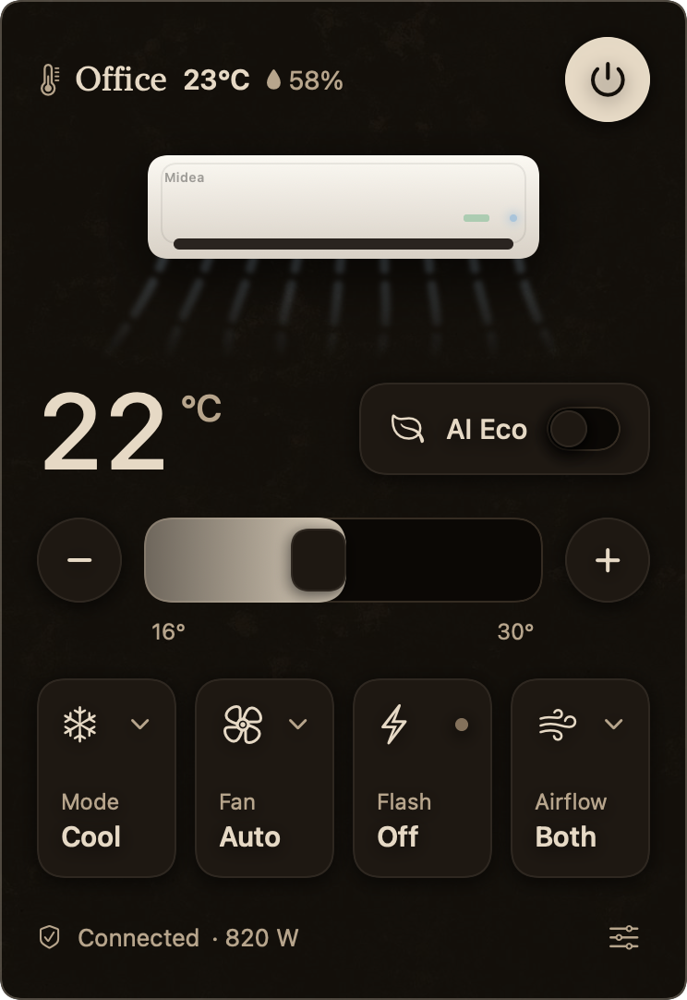

# Breeze

A macOS menu bar app by [Arika Labs](https://github.com/ArikaLabs) that controls a Midea air conditioner over your local network.
No cloud round-trips for control: the app speaks Midea's LAN protocol (V3, TCP 6444)
directly to the unit's built-in Wi-Fi module, so commands take a few milliseconds and keep
working when Midea's servers don't.

<p align="center"></p>

- Power, mode, target temperature in 0.5 °C steps, fan speed, swing, Eco / AI ECOMASTER, Turbo / Flash,
  Sleep, Breeze Away / Breezeless, self clean, display toggle
- Room temperature and humidity from the unit's own sensors, live power draw and kWh counters
- Siri and Shortcuts (App Intents), a `breeze://` URL scheme, and a command line tool
- Several units, with a switcher in the header
- Follows the system appearance: Travertine by day, Basalt by night, in the Arika Labs house style
- A nudge to turn the AC on when your Mac's chip runs hot and the room is warm

## Will it work with my unit?

Breeze talks to Midea air conditioners (appliance type `0xAC`) whose Wi-Fi module uses the **V3 LAN
protocol**, which covers most units sold in recent years, including many rebrands built by Midea.
The unit must be paired in the **MSmartHome** app: Midea's cloud only hands out the per-device LAN
token to the owning account, and the older NetHome Plus endpoint has refused new tokens since
August 2026. If your unit is in NetHome Plus, add it to MSmartHome first.

It has been tested on one unit, a Midea AI ECOMASTER / Prime Guard split (remote RG10E21). Everything
the app shows is driven by the capability list the unit reports, so other models should show the
features they actually have. If yours misbehaves, open an issue with **Settings → Copy diagnostics**
attached.

## Install

**Download:** [breeze.arikalabs.com/download](https://breeze.arikalabs.com/download), or open `Breeze.dmg` from the [latest release](../../releases/latest), and drag
Breeze into Applications. The app is not notarized by Apple (there is no paid developer account behind
it), so macOS blocks the first launch. Allow it once:

1. Double-click Breeze. macOS says it cannot verify the app. Click **Done** on macOS 15, or **Cancel** on macOS 14 (not Move to Trash).
2. Within the hour, open **System Settings → Privacy & Security**, scroll down to Security, and click **Open Anyway**
   next to the Breeze message. Confirm with your password or Touch ID. On macOS 14 you can instead Control-click Breeze in Applications and choose **Open**.
3. Breeze now opens normally every time. It lives in the menu bar, not the Dock.

If you prefer Terminal: `xattr -dr com.apple.quarantine /Applications/Breeze.app` does the same.

**Build from source** (Xcode 16+ command line tools, macOS 14+):

```sh
swift test                            # protocol vectors from the Python reference + an in-process fake unit
./scripts/build-app.sh --install --run  # builds build/Breeze.app, copies it to ~/Applications, launches it
```

The build script signs with a "Developer ID Application" identity when one is in the keychain
(or `CODESIGN_IDENTITY=…`), otherwise ad hoc. With a stable signature the credentials move to the Keychain.
`scripts/make-dist.sh` packages the app as a DMG and zip; with `NOTARY_PROFILE=<notarytool profile>` it
also notarizes and staples them, which removes the first-launch warning for everyone.

## First run

1. Click the air-conditioner icon in the menu bar. Breeze scans the LAN (UDP 6445/20086)
   and lists every Midea unit it finds.
2. Pick your unit, then sign in with the MSmartHome account the unit is paired with. Breeze calls
   Midea's cloud once to fetch the token and key, verifies them against the unit, and stores them
   in `~/Library/Application Support/Breeze/credentials.json` (0600) or the Keychain.
   Your password is used for that one call and never stored.
3. If several units answered, use **Settings → Identify** to blink a unit's display.

Back up the token and key afterwards (**Settings → Copy token & key**). Midea can stop issuing
them at any time, and they are the only way to control the unit locally.

## What leaves your Mac

One HTTPS login to Midea's SmartHome cloud (`mp-prod.appsmb.com`) during setup, to fetch the
token. After that, only LAN traffic to the unit. No analytics, no telemetry, no other servers.

## Automation

**Siri and Shortcuts.** Breeze ships App Intents (Turn On / Turn Off / Set Temperature / Set Mode /
Get Status, each with an optional unit name) and three App Shortcuts: "Start cooling with Breeze",
"Stop cooling with Breeze" and "Breeze status". They appear in the Shortcuts app under Breeze after the
first launch. The `shortcuts/` folder holds three example shortcuts built on the URL scheme; sign them
with `shortcuts sign --mode anyone --input … --output …` before importing.

**URL scheme** (Shortcuts "Open URL", AppleScript `open location`, or `open` in a script):

```
breeze://cool?temp=22            power on, Cool, 22 °C (°F if the app is set to Fahrenheit)
breeze://off                     power off
breeze://power?on=toggle         toggle power
breeze://set?mode=heat&fan=low&swing=vertical&eco=on
breeze://show                    open the popover
…&unit=Meeting%20room            target a specific unit (default: the selected one; an unknown name does nothing and shows a notification)
```

**CLI.** `swift build -c release` also produces `.build/release/midea-cli`, which can reuse what the app linked:

```sh
midea-cli discover
midea-cli query --saved --caps
midea-cli set --saved power=on mode=cool temp=23 fan=auto swing=vertical
midea-cli monitor --saved                       # prints every state change
midea-cli token --account you@example.com --password '…' --id <device id>
midea-cli query <unit ip> --id <device id> --token <hex> --key <hex>
```

## Energy, diagnostics, backup

- Refresh cadence: the unit does not push updates, so Breeze polls it. Every 5 minutes by default in
  the background (Settings → Refresh every: 1, 5, 10 or 30 minutes), every 15 s while the popover is
  open, and immediately when the popover opens or after a command. The menu bar reading can therefore
  lag by up to one interval.
- The header shows the room temperature and, next to a droplet, the indoor relative humidity, both
  measured by sensors in the indoor unit (humidity only on units that report it).
- When the unit reports energy data, Breeze samples power draw and the unit's kWh counter on each
  refresh into `~/Library/Application Support/Breeze/energy.sqlite` (table `samples`). Settings shows
  today / 7-day / lifetime figures.
- Settings → Copy diagnostics puts the recent log (also in Console under subsystem `com.arikalabs.breeze`)
  and a status summary on the clipboard.
- Settings → Self clean starts the unit's evaporator cleaning cycle (units that report the capability).
- Cooling suggestions: the Mac's SoC temperature (IOKit HID sensors) and `ProcessInfo.thermalState`
  are sampled every 30 s; when the Mac is hot, the selected AC is off and the room is warm, the menu
  bar icon turns orange, the popover shows a banner and a notification offers "Turn on AC".

## Layout

```
Sources/MideaKit     Swift port of the Midea LAN protocol (discovery, 0x8370 framing,
                     AES/MD5/SHA256 signing, 0xAC command/response frames, SmartHome
                     cloud token fetch)
Sources/MideaCLI     midea-cli: discover / token / list / query / set / display / monitor
Sources/Breeze       The menu bar app (AppKit status item + NSPopover + SwiftUI)
Tests/MideaKitTests  Byte-exact tests against vectors generated from msmart-ng, plus a fake unit
scripts/             Info.plist, app bundle + icon build script
shortcuts/           Example Shortcuts using the URL scheme
```

## How control works

| Layer | Detail |
|---|---|
| Discovery | UDP broadcast of a fixed 72-byte probe; reply is AES-128-ECB encrypted with `md5("xhdiwjnchekd4d512chdjx5d8e4c394D2D7S")`, carries IP, port, serial, SSID (`net_ac_XXXX`) and the 48-bit device id |
| Session | TCP 6444. `0x8370` handshake: send the 64-byte cloud *token*; the unit replies with 32 bytes AES-256-CBC(zero IV) under the cloud *key* plus SHA-256; session key = plaintext ⊕ key |
| Requests | Appliance frame `AA len AC … type | payload msgId crc8 | checksum` → AES-ECB + MD5-signed LAN packet → AES-CBC(session key) + SHA-256 inside an `0x8370` type-6 frame |
| Commands | `0x41` query state, `0x40` set state, `0xB5` capabilities, `0xB1/0xB0` get/set properties (AI ECOMASTER = property `0x00E3`, Cool/Heat Flash = `0x0067`, breeze modes, swing angles), `0x41 0x21` group data (energy, humidity) |

## Credits

Protocol work leans on [mill1000/midea-msmart](https://github.com/mill1000/midea-msmart) and
[wuwentao/midea_ac_lan](https://github.com/wuwentao/midea_ac_lan); the test vectors are generated
from msmart-ng. The popover design follows
[@icanberk's status bar AC concept](https://x.com/icanberk/status/2109031477484937571).

Breeze is made by Arika Labs. MIT licensed. Not affiliated with Midea.
